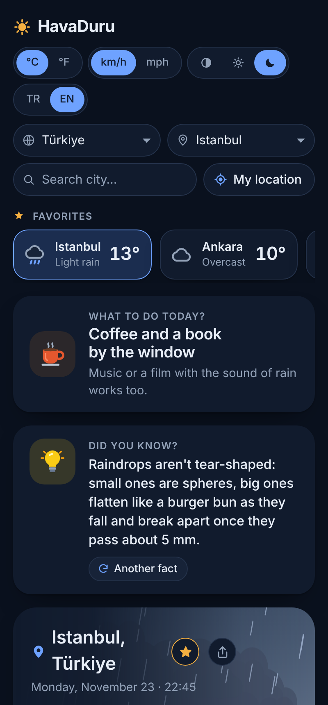
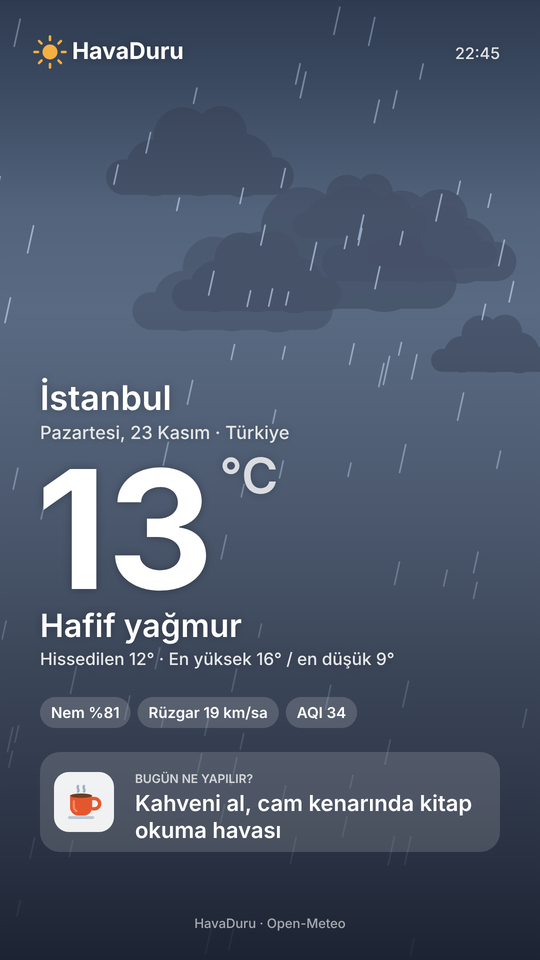
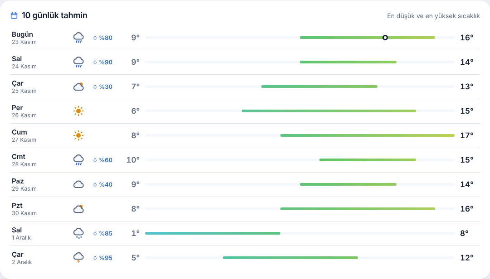
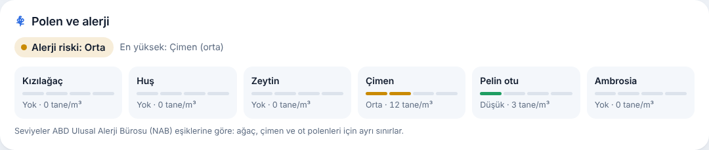
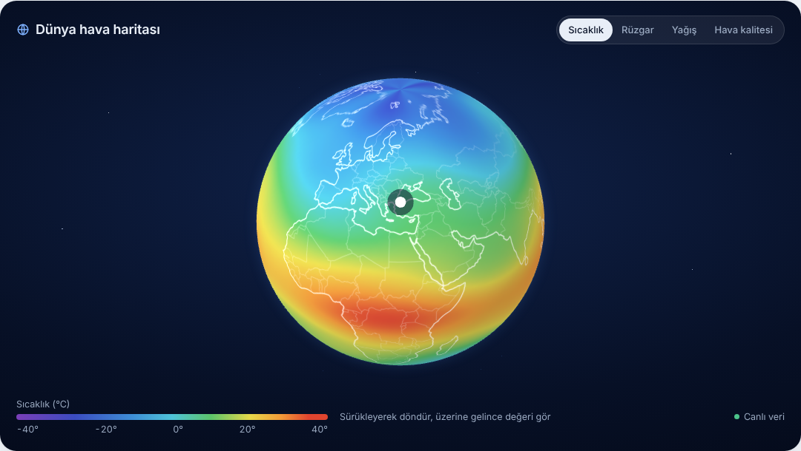

# HavaDuru — Android

HavaDuru web sitesinin **Kotlin ile yazılmış native Android uygulaması**. Sitedeki tasarım, renkler, yazı tipleri ve hareketli gökyüzü sahnesi aynen korunur. Bunlara ek olarak **bildirimler** ve **ana ekran widget'ı** vardır.

- Dış kütüphane yok, yalnızca Android'in kendi bileşenleri kullanılır. APK küçük ve hızlıdır.
- Android 8.0 (API 26) ve üstünde çalışır.
- API anahtarı gerekmez.

## Görünüm

Uygulama, web sürümüyle aynı tasarımı kullanır. Aşağıdaki görseller **HavaDuru web sürümünden** alınmıştır (örnek veriyle):

  
  &nbsp;
  

> **Uygulamanın kendi ekran görüntüleri:** Depoda **Actions → Ekran görüntüleri → Run workflow** çalıştırılırsa uygulama bir Android emülatöründe canlı veriyle açılır. Ekran görüntüleri indirilebilir dosya olarak yüklenir. Bu iş akışı yalnızca elle başlatılır; normal derlemeyi etkilemez.

## Özellikler

**Hava durumu**
- Ülke ve şehir seçimi (Türkiye'den 38 il dahil 16 ülke) ve dünyadaki tüm şehirlerde arama
- **Konumum:** telefonun konumuyla bulunduğun yerin havası
- Büyük derece ve havaya göre değişen hareketli gökyüzü: güneş, bulut, yağmur, şimşek, kar, sis, gece yıldızları ve hilal. Hava değişince sahne yumuşakça geçiş yapar, sayılar akarak değişir.
- Dünle karşılaştırma ("Dünden 3° daha sıcak")
- Nem, hava kalitesi (AQI), rüzgar, basınç, UV indeksi, yağış ihtimali
- Polen ve alerji seviyesi: kızılağaç, huş, zeytin, çimen, pelin otu, ambrosia (yalnızca Avrupa)
- 24 saatlik ve 7 günlük sıcaklık grafiği (dokununca değer)
- 10 günlük tahmin
- Gün doğumu / batımı yayı ve ay evresi

**Öneriler**
- "Bugün ne yapılır?" kartı: hava ve dereceye göre renkli simgeli aktivite önerisi
- "Biliyor muydun?" kartı: havaya uygun 31 ilginç bilgi

**Haritalar**
- **3B dünya küresi (OpenGL):** sıcaklık, rüzgar, yağış ve hava kalitesi katmanları. Sürükleyerek döndürülür, dokununca o noktanın değeri görünür.
- **Yağış radarı:** son 2 saatin yağışı harita üzerinde oynatılır; kaydırma ve yakınlaştırma yapılabilir.

**Bildirimler** (Ayarlar'dan açılıp kapatılır)
- **Sabah özeti:** her sabah 07:00'den sonra günün havası ve aktivite önerisi
- **Hava uyarıları:**
  - 12 saat içinde gök gürültülü fırtına
  - Şiddetli yağış (yağış ihtimali %80 ve üstü)
  - Aşırı sıcak (35° ve üstü)
  - Don (0° ve altı)
  - Kuvvetli rüzgar (50 km/sa ve üstü)
- Her uyarı günde en fazla bir kez gönderilir. Uygulama arka planda saatte bir veriyi yeniler.

**Widget**
- Ana ekran için yeniden boyutlandırılabilir widget
- Arka planında seçili şehrin gökyüzü sahnesi; üzerinde şehir, derece, simge, durum, en yüksek ve en düşük sıcaklık
- Dokununca uygulama açılır

**Kişiselleştirme ve paylaşım**
- En fazla 5 favori şehir
- °C / °F, km/sa / mph, Türkçe / İngilizce, açık / koyu / cihaz teması
- Hikaye (9:16) ve kare (1:1) hava kartı: doğrudan paylaşılabilir ya da Galeri'ye kaydedilebilir (Android 10+)

## APK'yı indirme ve kurma

1. Depoda **Actions** sekmesine gir ve en son başarılı **Android APK** çalışmasını aç.
2. **Artifacts** bölümünden **HavaDuru-apk** dosyasını indir ve zip'i aç.
3. `release/app-release.apk` dosyasını telefona at ve aç. Telefon "bilinmeyen kaynaklardan yükleme" izni isteyebilir.

Release APK, kişisel kullanım için hata ayıklama anahtarıyla imzalanır. Play Store'a yüklemek için `app/build.gradle.kts` içine kendi imza anahtarını eklemen gerekir.

## Kendin derlemek

- Android Studio (Koala ya da daha yeni) ile projeyi aç ve **Run** de, ya da
- Terminalde: `./gradlew assembleDebug` (JDK 17 gerekir)

| Sürüm | |
|---|---|
| Gradle | 8.9 |
| Android Gradle Plugin | 8.7.3 |
| Kotlin | 2.0.21 |
| compileSdk / targetSdk | 34 |
| minSdk | 26 (Android 8.0) |

## İzinler

| İzin | Neden |
|---|---|
| İnternet | Hava durumu, harita ve radar verisi |
| Yaklaşık konum | Yalnızca "Konumum" düğmesine basınca istenir |
| Bildirimler | Sabah özeti ve hava uyarıları (Android 13+ ilk açılışta sorulur) |
| Açılışta çalışma | Telefon yeniden başlayınca saatlik yenilemenin devam etmesi |

## Proje yapısı

| Dosya | İçerik |
|---|---|
| `MainActivity.kt` | Ana ekran, ayarlar, paylaşım penceresi |
| `Sky.kt` | Hareketli gökyüzü sahnesi (uygulama, widget ve kart ortak kullanır) |
| `Views.kt` | Sıcaklık grafiği, 10 günlük tahmin, güneş yayı, ay evresi |
| `Globe.kt` | 3B dünya küresi (OpenGL ES 2.0) ve doku boyama |
| `Radar.kt` | Karo tabanlı yağış radarı haritası |
| `Background.kt` | Bildirimler, saatlik arka plan işi, widget |
| `Api.kt` / `Demo.kt` | Servis istemcileri / internet yokken örnek veri |
| `Model.kt` / `Strings.kt` / `GeneratedData.kt` | Veri modeli, kurallar, TR/EN metinler, şehir listesi |
| `Share.kt` | Paylaşılabilir hava kartı |

## Kullanılan servisler

| Ne için | Kaynak | Not |
|---|---|---|
| Hava tahmini, küre verisi | [Open-Meteo](https://open-meteo.com/) | Ücretsiz, anahtarsız (ticari olmayan kullanım), CC BY 4.0 |
| Hava kalitesi ve polen | [Open-Meteo Air Quality](https://open-meteo.com/en/docs/air-quality-api) | Polen yalnızca Avrupa için |
| Şehir arama | [Open-Meteo Geocoding](https://open-meteo.com/en/docs/geocoding-api) | |
| Konumdan şehir adı | [BigDataCloud](https://www.bigdatacloud.com/free-api/free-reverse-geocode-to-city-api) | Ücretsiz, anahtarsız |
| Yağış radarı | [RainViewer](https://www.rainviewer.com/api.html) | En fazla 7. yakınlaştırma, dakikada 100 istek |
| Harita zemini | [CARTO](https://carto.com/attributions) / [OpenStreetMap](https://www.openstreetmap.org/copyright) | |
| Kıyı ve sınır çizgileri | [Natural Earth](https://www.naturalearthdata.com/) | Kamu malı |
| Yazı tipleri | [Bricolage Grotesque](https://github.com/ateliertriay/bricolage), [Instrument Sans](https://github.com/Instrument/instrument-sans) | SIL Open Font License (`assets/fonts`) |

Notlar:
- Polen seviyeleri ABD Ulusal Alerji Bürosu (NAB) eşiklerine göre hesaplanır.
- Ay evresi cihazda hesaplanır.
- İnternet yoksa uygulama üstte belirterek örnek veri gösterir. Bu durumda bildirim gönderilmez.
